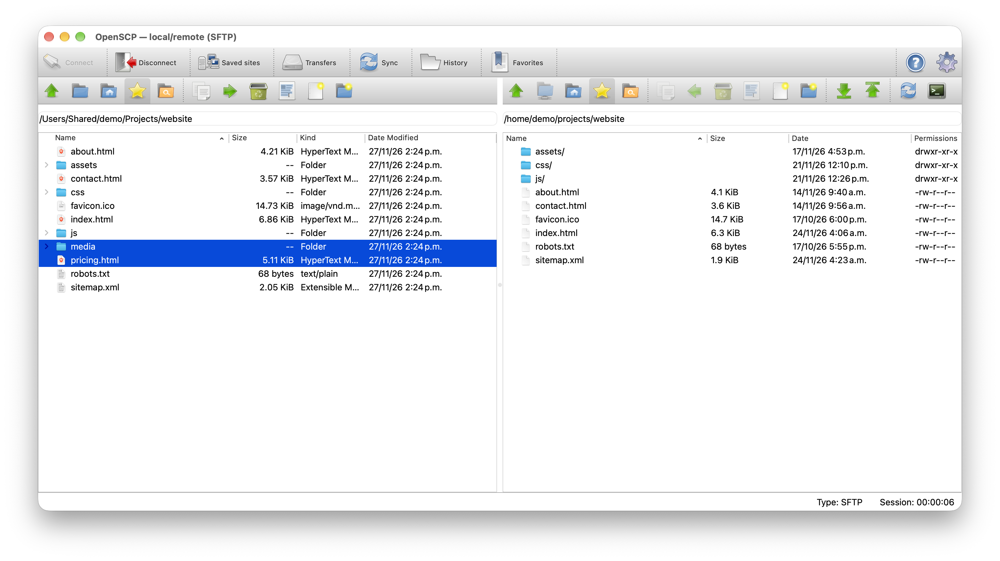
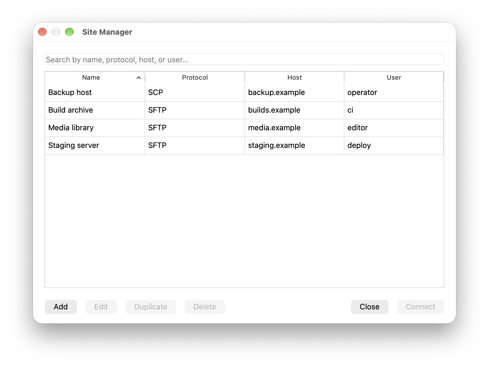
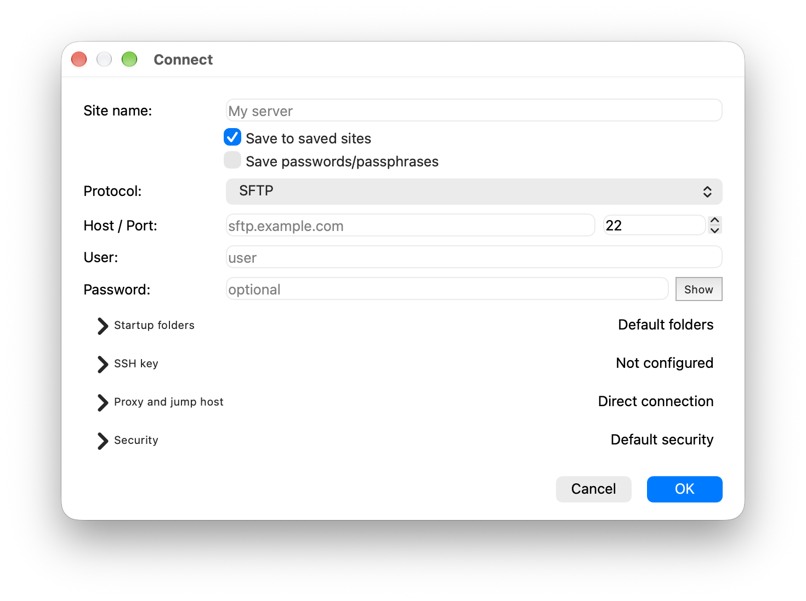
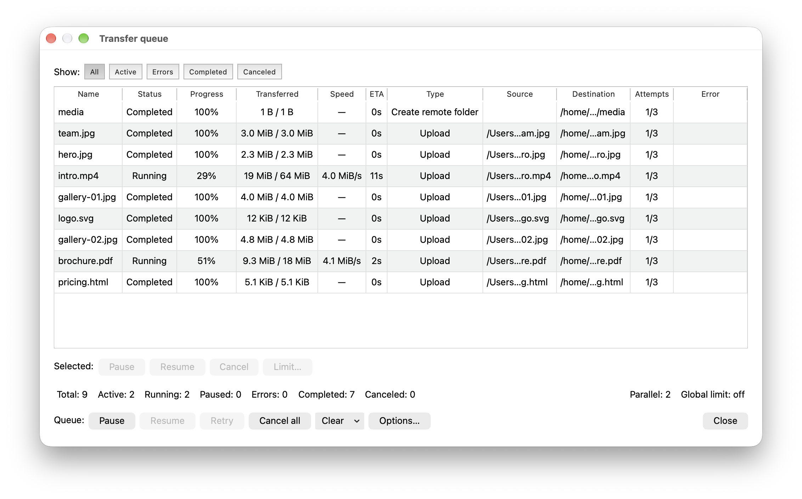
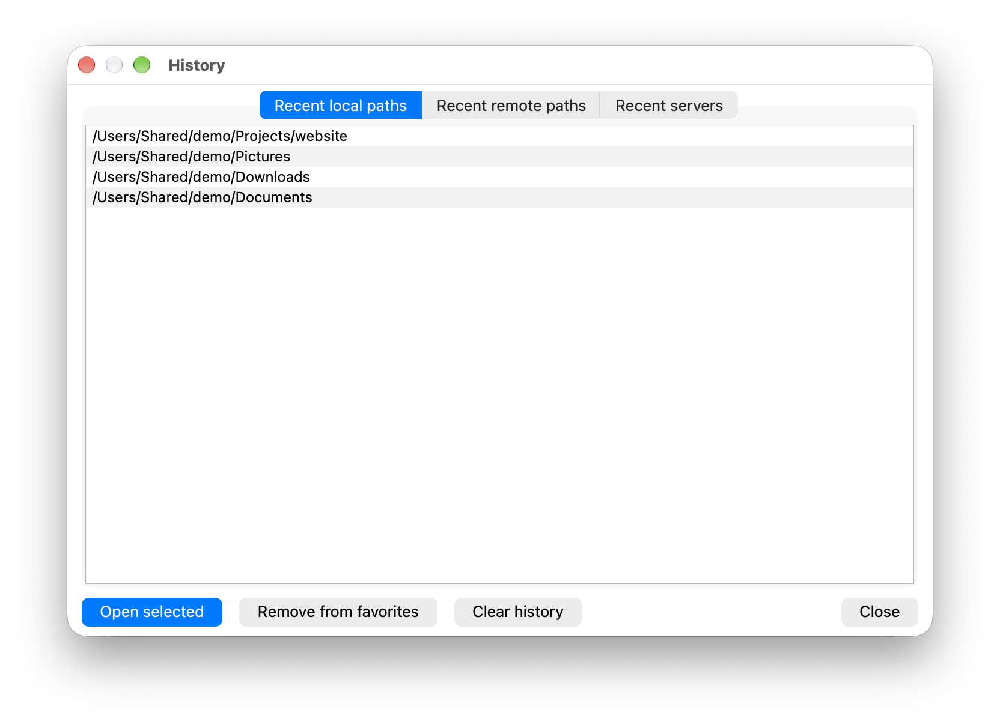
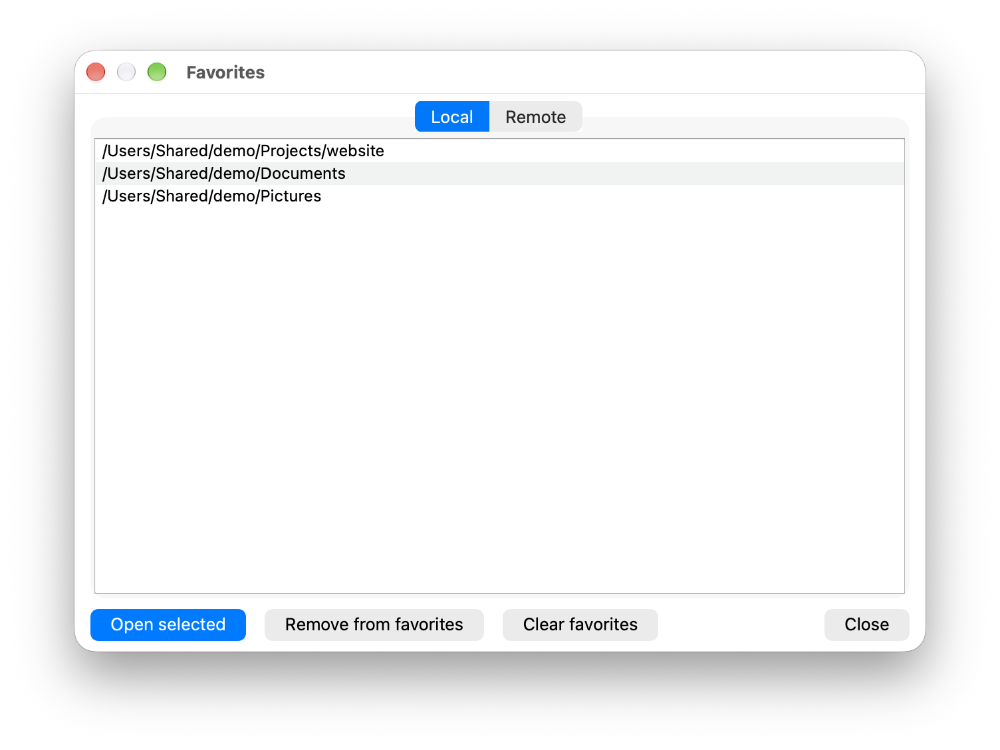
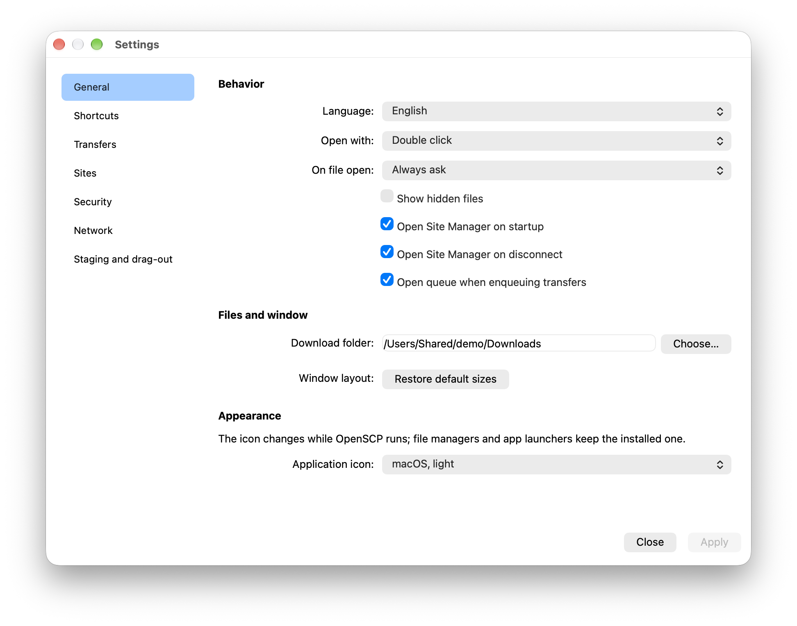
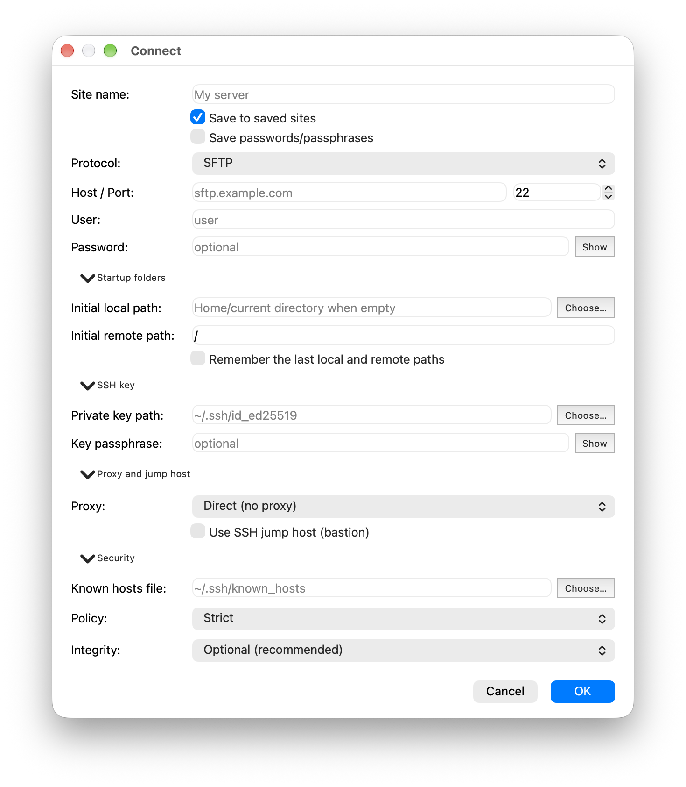

<div align="center">
  
  <h1>OpenSCP</h1>

  <p><strong>A cross-platform SFTP, SCP, FTP, FTPS, and WebDAV client with a WinSCP-style dual-pane interface.</strong></p>
  <p><a href="https://github.com/luiscuellar31/openscp/releases/latest"></a></p>
  <p><a href="#download">Download</a> · <a href="#features">Features</a> · <a href="#screenshots">Screenshots</a> · <a href="#documentation">Documentation</a> · <a href="README_ES.md">Leer en español</a></p>

  
</div>

OpenSCP moves and manages files between your computer and a server. It shows
local and remote files side by side in two panels, with a transfer queue,
one-way synchronization, and secure defaults, and it runs on macOS, Linux, and
Windows.

## Features

- **Two panels:** local and remote files side by side, with flat clickable
  paths, an Open Directory dialog, history, favorites, search, and
  drag-and-drop.
- **Protocols:** SFTP, SCP, FTP, FTPS, and WebDAV. The Flatpak bundle has SFTP
  and SCP only; see the
  [protocol matrix](docs/PLATFORM_COMPATIBILITY.md#protocol-availability-by-build).
- **Transfers:** a persistent queue with parallel workers, pause, resume,
  retry, conflict policies, bandwidth limits, and resumable `.part` files.
- **Saved sites:** passwords kept in the Keychain on macOS, Secret
  Service/libsecret on Linux, and with DPAPI encryption on Windows.
- **Server identity:** strict, accept-new, or explicitly disabled SSH host-key
  verification. Keys that `known_hosts` marks `@revoked` are refused, as OpenSSH
  does. FTPS and HTTPS WebDAV without certificate verification still check the
  server's public key, which you trust on the first connection.
- **Proxies:** SOCKS5, HTTP CONNECT, and SSH jump hosts where the protocol
  allows it.
- **Synchronization:** one-way, with preview, filters, and optional checksum
  checks.
- **Languages:** Spanish, English, Portuguese, French, and German.

The [user guide](docs/USAGE.md) explains how connections, transfers, and
synchronization behave in unusual cases.

## Screenshots

<p align="center">
  
  
  
</p>

<p align="center">
  
  
  
</p>

<details>
  <summary>Advanced connection options</summary>
  <p align="center">
    
  </p>
</details>

## Download

Prebuilt binaries for every tagged release are on the
[Releases page](https://github.com/luiscuellar31/openscp/releases/latest).

| Platform | File |
| --- | --- |
| macOS 13 or later, Apple Silicon | `OpenSCP-<version>-arm64-UNSIGNED.dmg` |
| macOS 13 or later, Intel | `OpenSCP-<version>-x86_64-UNSIGNED.dmg` |
| Linux x86_64, glibc 2.34 or later | `OpenSCP-<version>-x86_64.AppImage` |
| Linux ARM64, glibc 2.39 or later | `OpenSCP-<version>-aarch64.AppImage` |
| Linux x86_64, Flatpak bundle | `OpenSCP-x86_64.flatpak` |
| Linux ARM64, Flatpak bundle | `OpenSCP-aarch64.flatpak` |
| Windows 10 version 1809 or later, x64 | `OpenSCP-<version>-x64-setup.exe` |
| Windows 10 version 1809 or later, x64, MSI for all users | `OpenSCP-<version>-x64.msi` |

Every release ships a `SHA256SUMS.txt` covering all of the above. Download it
next to the file you picked and check them together:

```bash
shasum -a 256 -c SHA256SUMS.txt --ignore-missing  # macOS
sha256sum -c SHA256SUMS.txt --ignore-missing      # Linux
```

On Windows, PowerShell prints `True` when the file matches:

```powershell
$file = 'OpenSCP-<version>-x64-setup.exe'
(Get-FileHash $file).Hash -eq (-split (Select-String -Path SHA256SUMS.txt -SimpleMatch "  $file").Line)[0]
```

Checksums catch a damaged download, not a replaced one. To confirm that a file
was built by this repository's release workflow, use the
[GitHub CLI](https://cli.github.com/):

```bash
gh attestation verify OpenSCP-<version>-x86_64.AppImage --repo luiscuellar31/openscp
```

### macOS

Open the DMG and drag OpenSCP onto the Applications folder, then launch it from
Applications.

The first launch is blocked: macOS reports that it cannot check the app for
malicious software. That check is reserved for software signed with a paid
Apple Developer ID, and OpenSCP is not enrolled in that program, so every build
is flagged the same way regardless of what it contains. The published checksum
is what lets you verify the download instead.

To allow it, open **System Settings → Privacy & Security**, scroll down to the
Security section, click **Open Anyway** next to the message about OpenSCP, and
confirm. OpenSCP then starts normally, including after a restart.

The equivalent from a terminal:

```bash
xattr -dr com.apple.quarantine /Applications/OpenSCP.app
```

Two consequences worth knowing about: on macOS 15 and later the older
Control-click → Open shortcut no longer works, so the Privacy & Security route
above is the only one in the interface; and because unsigned builds have no
stable identity, macOS asks for keychain permission again after each update
when OpenSCP reads your saved passwords.

### Linux

The AppImage needs no installation and runs on most distributions:

```bash
chmod +x OpenSCP-<version>-x86_64.AppImage
./OpenSCP-<version>-x86_64.AppImage
```

The Flatpak bundle integrates with the desktop and runs confined:

```bash
flatpak remote-add --user --if-not-exists flathub https://flathub.org/repo/flathub.flatpakrepo
flatpak install --user ./OpenSCP-x86_64.flatpak
flatpak run io.github.luiscuellar31.openscp
```

The Flathub remote is needed because the bundle depends on the KDE runtime.

### Windows

OpenSCP needs Windows 10 version 1809 or later, or Windows 11, on x64. Run
`OpenSCP-<version>-x64-setup.exe`: it installs OpenSCP for your user, without
administrator rights, unless you choose to install it for all users. For
deployment tools, the MSI installs it for all users, also silently:

```powershell
msiexec /i OpenSCP-<version>-x64.msi /qn
```

The installers are not code-signed, so SmartScreen shows **Windows protected
your PC** the first time. Click **More info**, then **Run anyway**. As on
macOS, the published checksum is what lets you verify the download.

**Open in terminal** and SSH jump hosts use the OpenSSH client of Windows; if
it is missing, add **OpenSSH Client** under **Optional features** in Windows
Settings.

Like a browser, OpenSCP marks the files it downloads as coming from the
internet, so Windows checks them before they open. Servers that you add to
**Local intranet** or **Trusted sites** in Internet Options are not marked.

### Updates

Use **OpenSCP → Check for updates…** (**Help → Check for updates…** on Windows)
to check for a newer stable release. **Automatically check for updates** enables
a daily check; it is off by default. Whether OpenSCP can install the update
itself depends on how you installed it: see
[Updating OpenSCP](docs/UPDATES.md).

## Build from source

OpenSCP is written in C++20 with Qt 6 and builds on Linux, macOS, and Windows.
A compatible Qt 6 installation, CMake 3.22+, libssh2, and OpenSSL are required.
libcurl enables optional FTP and FTPS support; WebDAV also requires tinyxml2.
On Windows, Visual Studio 2022 builds it against Qt for MSVC, and vcpkg builds
the other libraries.

```bash
git clone https://github.com/luiscuellar31/openscp.git
cd openscp

# Linux
./scripts/linux.sh dev

# macOS
./scripts/macos.sh dev
```

```powershell
# Windows (PowerShell)
$env:VCPKG_ROOT = 'C:\path\to\vcpkg'
.\scripts\windows.ps1 dev
```

For distribution-specific dependencies, manual build steps, packaging, and
troubleshooting, see [Building OpenSCP](docs/BUILDING.md).

## Documentation

- [Using OpenSCP](docs/USAGE.md)
- [Keyboard shortcuts](docs/KEYBOARD_SHORTCUTS.md)
- [Updating OpenSCP](docs/UPDATES.md)
- [Platform and protocol compatibility](docs/PLATFORM_COMPATIBILITY.md)
- [Building and packaging](docs/BUILDING.md)
- [Architecture](docs/ARCHITECTURE.md)
- [Accessibility testing](docs/ACCESSIBILITY.md)
- [Contributing and translations](CONTRIBUTING.md)
- [Security policy](SECURITY.md)
- [Licensing](docs/LICENSING.md)

## Roadmap

- Sign the Windows packages.
- Test WebDAV with a wider range of servers.
- Support interactive authentication and more enterprise proxy and SSH
  jump-host setups.
- Add a command palette and selectable themes.

## Contributing

Contributions are welcome. Read [CONTRIBUTING.md](CONTRIBUTING.md) before
opening a pull request: `main` contains stable work and `dev` is the
pull-request target. Report vulnerabilities privately as described in
[SECURITY.md](SECURITY.md).

## License

OpenSCP is available under GPLv3-only or a commercial license. Third-party
components retain their own licenses; see [Licensing](docs/LICENSING.md) and
[third-party credits](docs/credits/CREDITS.md).
