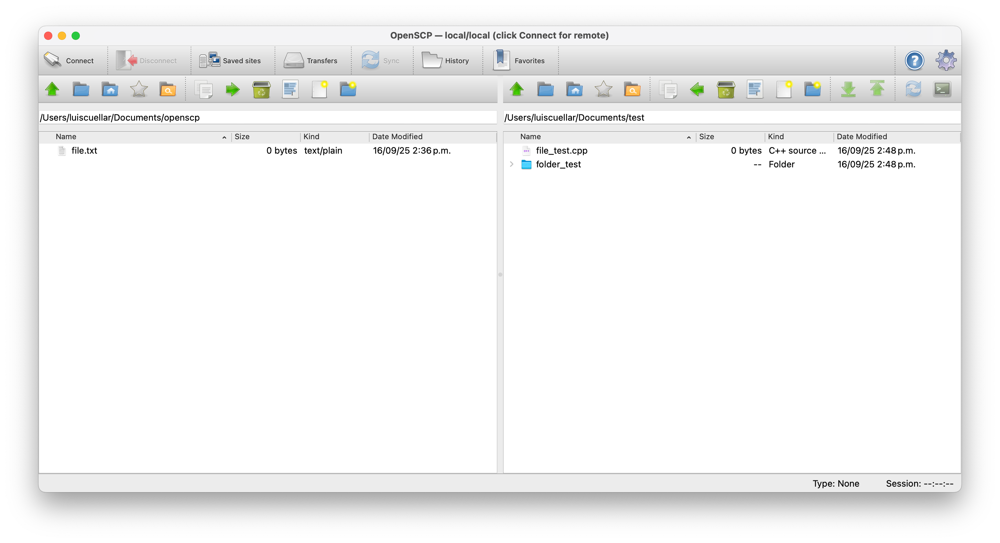
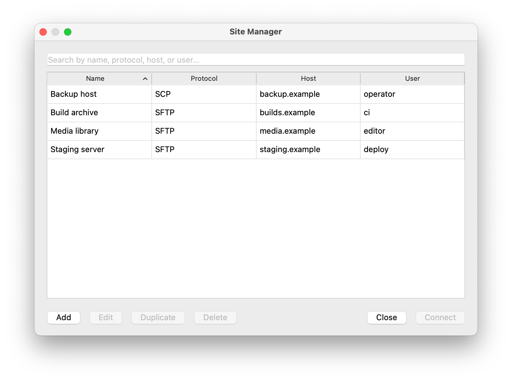
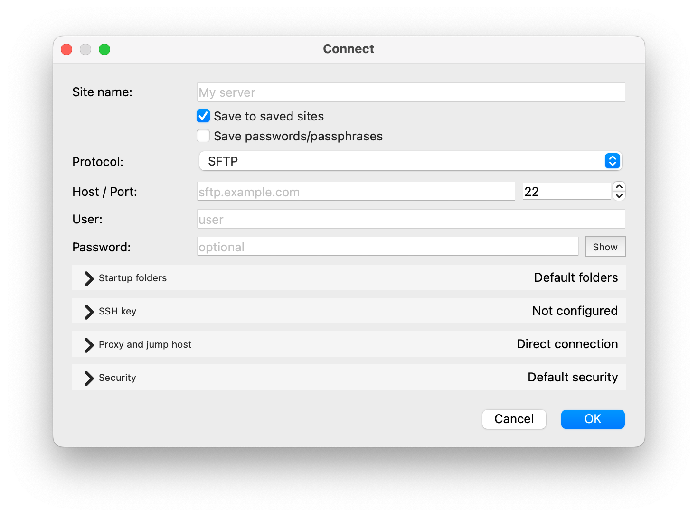
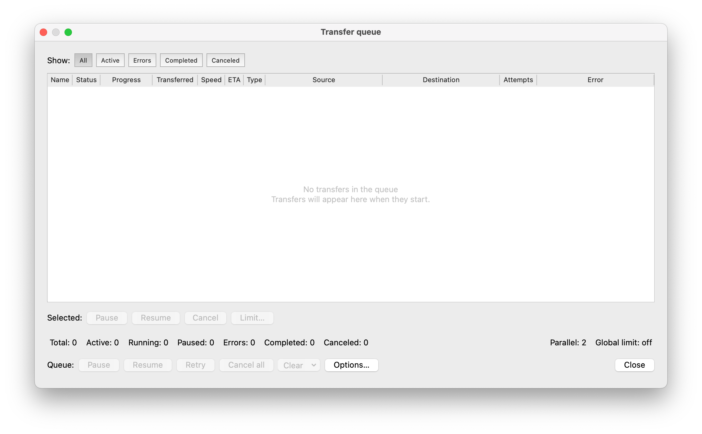
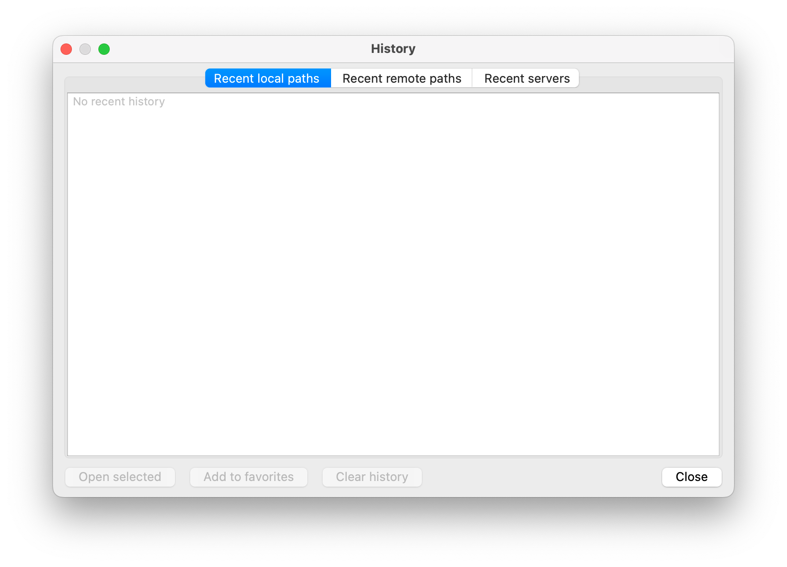
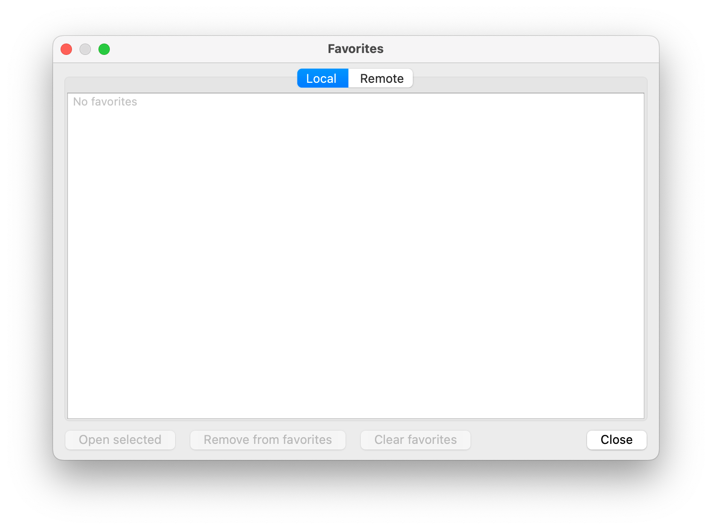
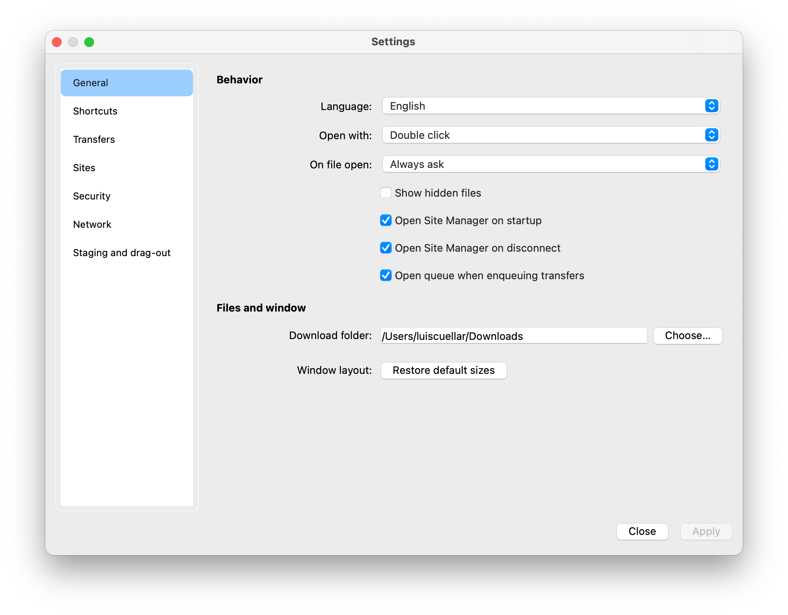
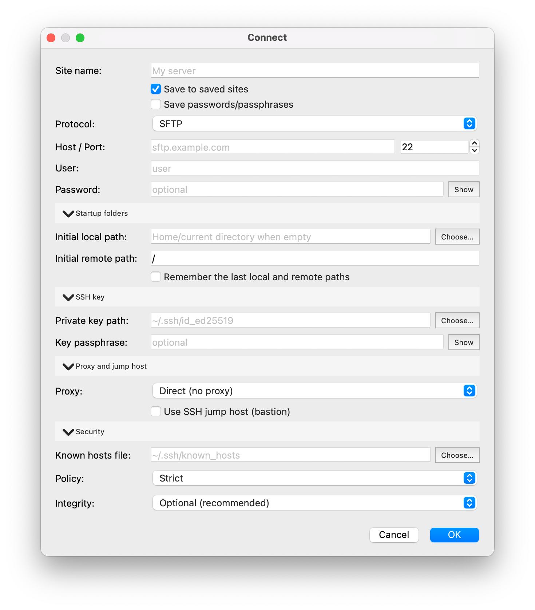

<div align="center">
  
  <h1>OpenSCP</h1>

  <p><strong>Un cliente ligero y multiplataforma para transferir archivos, con flujo de trabajo de doble panel, configuración segura por defecto y compatibilidad con SFTP, SCP, FTP, FTPS y WebDAV.</strong></p>
  <p><a href="README.md">Read in English</a></p>

  
</div>

OpenSCP es una aplicación de escritorio escrita en C++20 y Qt 6 para mover y
administrar archivos entre sistemas locales y remotos. Prioriza un
comportamiento predecible, configuraciones seguras y una interfaz familiar de
doble panel.

## Descarga

Los binarios precompilados de cada versión etiquetada están en la
[página de Releases](https://github.com/luiscuellar31/openscp/releases/latest).

| Plataforma | Archivo |
| --- | --- |
| macOS, Apple Silicon | `OpenSCP-<versión>-arm64-UNSIGNED.dmg` |
| macOS, Intel | `OpenSCP-<versión>-x86_64-UNSIGNED.dmg` |
| Linux, x86_64 | `OpenSCP-<versión>-x86_64.AppImage` |
| Linux, ARM64 | `OpenSCP-<versión>-aarch64.AppImage` |
| Linux, paquete Flatpak | `OpenSCP-x86_64.flatpak`, `OpenSCP-aarch64.flatpak` |
| Windows 10 y 11, x64 | `OpenSCP-<versión>-x64-setup.exe` |
| Windows, x64, MSI para todos los usuarios | `OpenSCP-<versión>-x64.msi` |

Cada versión incluye un `SHA256SUMS.txt` que cubre todos esos archivos.
Descárgalo junto al que hayas elegido y compruébalos juntos:

```bash
shasum -a 256 -c SHA256SUMS.txt --ignore-missing  # macOS
sha256sum -c SHA256SUMS.txt --ignore-missing      # Linux
```

En Windows, PowerShell muestra `True` cuando el archivo coincide:

```powershell
$file = 'OpenSCP-<versión>-x64-setup.exe'
(Get-FileHash $file).Hash -eq (-split (Select-String -Path SHA256SUMS.txt -SimpleMatch "  $file").Line)[0]
```

Las sumas de comprobación detectan una descarga dañada, no un archivo
sustituido. Para confirmar que un archivo lo generó el workflow de publicación
de este repositorio, usa la [CLI de GitHub](https://cli.github.com/):

```bash
gh attestation verify OpenSCP-<versión>-x86_64.AppImage --repo luiscuellar31/openscp
```

### Actualizaciones

Usa **OpenSCP → Buscar actualizaciones…** (**Ayuda → Buscar actualizaciones…**
en Windows) para consultar la última versión estable.
**Buscar actualizaciones automáticamente** activa una consulta diaria;
está desactivada por defecto. La instalación requiere confirmación y que hayan
terminado las operaciones de archivos pendientes. Los builds configurados con
firmas pueden instalar actualizaciones de AppImage, macOS y el instalador de
Windows; los demás abren la página de la versión. Flatpak y Snap usan su gestor de software. Los paquetes
Flatpak independientes requieren descargar el nuevo paquete si no se configuró
un repositorio de actualizaciones.
Consulta [Cómo actualizar OpenSCP](docs/UPDATES.md) para más detalles.

### Instalación en macOS

Abre el DMG, arrastra OpenSCP a la carpeta Aplicaciones y ábrelo desde ahí.

La primera apertura queda bloqueada: macOS indica que no puede comprobar si la
aplicación contiene software malicioso. Esa comprobación está reservada al
software firmado con un Apple Developer ID de pago, y OpenSCP no está inscrito
en ese programa, así que todas sus compilaciones reciben el mismo aviso
independientemente de su contenido. La suma de verificación publicada es lo que
te permite validar la descarga.

Para permitirla, abre **Ajustes del Sistema → Privacidad y seguridad**, baja
hasta la sección Seguridad, pulsa **Abrir igualmente** junto al mensaje sobre
OpenSCP y confirma. A partir de ahí OpenSCP se abre con normalidad, también
después de reiniciar.

El equivalente desde la terminal:

```bash
xattr -dr com.apple.quarantine /Applications/OpenSCP.app
```

Dos consecuencias que conviene conocer: en macOS 15 y posteriores el antiguo
atajo de Control-clic → Abrir ya no funciona, por lo que la ruta de Privacidad
y seguridad es la única disponible en la interfaz; y como las compilaciones sin
firmar no tienen una identidad estable, macOS vuelve a pedir permiso de llavero
después de cada actualización cuando OpenSCP lee tus contraseñas guardadas.

### Instalación en Linux

El AppImage no requiere instalación y funciona en la mayoría de distribuciones:

```bash
chmod +x OpenSCP-<versión>-x86_64.AppImage
./OpenSCP-<versión>-x86_64.AppImage
```

El paquete Flatpak se integra con el escritorio y se ejecuta confinado:

```bash
flatpak remote-add --user --if-not-exists flathub https://flathub.org/repo/flathub.flatpakrepo
flatpak install --user ./OpenSCP-x86_64.flatpak
flatpak run io.github.luiscuellar31.openscp
```

El remoto de Flathub es necesario porque el paquete depende del entorno de
ejecución de KDE.

### Instalación en Windows

OpenSCP necesita Windows 10 versión 1809 o posterior, o Windows 11, en x64.
Ejecuta `OpenSCP-<versión>-x64-setup.exe`: instala OpenSCP para tu usuario, sin
permisos de administrador, salvo que elijas instalarlo para todos los usuarios.
Para herramientas de despliegue, el MSI lo instala para todos los usuarios,
también en silencio:

```powershell
msiexec /i OpenSCP-<versión>-x64.msi /qn
```

Los instaladores no tienen firma de código, así que SmartScreen muestra
**Windows protegió su PC** la primera vez. Pulsa **Más información** y luego
**Ejecutar de todas formas**. Igual que en macOS, la suma de verificación
publicada es lo que te permite validar la descarga.

**Abrir en terminal** y los servidores de salto SSH usan el cliente OpenSSH de
Windows; si falta, agrega **Cliente OpenSSH** en **Características opcionales**
de la Configuración de Windows.

## Compilar desde el código fuente

OpenSCP se compila en Linux, macOS y Windows. Requiere Qt 6, CMake 3.22+,
libssh2 y OpenSSL. libcurl habilita FTP y FTPS; WebDAV requiere libcurl y
tinyxml2. En Windows lo compila Visual Studio 2022 con Qt para MSVC, y vcpkg
compila las demás bibliotecas.

```bash
git clone https://github.com/luiscuellar31/openscp.git
cd openscp

# Linux
./scripts/linux.sh dev

# macOS
./scripts/macos.sh dev
```

```powershell
# Windows (PowerShell)
$env:VCPKG_ROOT = 'C:\ruta\a\vcpkg'
.\scripts\windows.ps1 dev
```

Consulta [Compilar OpenSCP](docs/BUILDING.md) para dependencias por plataforma,
pasos manuales, empaquetado y solución de problemas.

## Características principales

- Navegación local y remota de doble panel con rutas planas y clicables, diálogo
  para abrir directorios, historial, favoritos, búsqueda y la posibilidad de
  arrastrar y soltar.
- SFTP y SCP mediante libssh2; FTP, FTPS y WebDAV opcionales mediante libcurl.
- Cola persistente con transferencias en paralelo, pausa, reanudación,
  reintentos, políticas de conflicto, límites de ancho de banda y archivos
  `.part`.
- Sitios guardados con Keychain en macOS, Secret Service/libsecret en Linux y
  cifrado DPAPI en Windows.
- Verificación estricta de claves SSH, con aceptación de claves nuevas o
  deshabilitada explícitamente.
- FTPS y WebDAV por HTTPS sin verificación del certificado siguen comprobando
  la clave pública del servidor, en la que confías en la primera conexión.
- Proxies SOCKS5 y HTTP CONNECT, además de servidores de salto SSH cuando el
  protocolo lo permite.
- Sincronización unidireccional con vista previa, filtros y sumas de
  comprobación opcionales.
- Interfaces en español, inglés, portugués, francés y alemán.

Cancelar una conexión o cerrar la ventana también cancela las solicitudes
pendientes de autenticación SSH y confirmación de huella. Los intentos de
conexión TCP de SSH comparten un límite de 20 segundos entre las direcciones
resueltas. La resolución de nombres usa el sistema y puede tardar más,
independientemente de ese límite TCP.

La sincronización nunca copia FIFOs, sockets ni dispositivos, y deja fuera los
nombres con barra invertida o caracteres de control, que las subidas también
rechazan. Un nombre que solo se diferencia de otro del lado contrario en
mayúsculas o normalización Unicode aparece como conflicto y no se copia ni se
borra.

Las descargas requieren archivos `.part` regulares. Si una entrada `.part`
existente es una FIFO (tubería con nombre), la descarga informa de un error de
E/S local sin esperar a un lector ni reemplazar esa entrada. Elige otro destino
o revisa la entrada en conflicto antes de reintentar.

Las transferencias que comparten un destino o su ruta `.part` se ejecutan en
serie. Los nombres locales que solo difieren en mayúsculas o normalización
Unicode también se ejecutan en serie, incluso en volúmenes que los distinguen.
Al eliminar una tarea con sus datos parciales, se conserva el `.part` mientras
otra tarea de la cola pueda reanudarse desde él, y no se borra nada de las
tareas terminadas ni de las subidas por SCP clásico, que escriben directamente
en el destino.

Al mover un archivo local al servidor en macOS y Linux, OpenSCP completa la
subida y conserva el origen local con una advertencia. El borrado automático no puede excluir que
otro proceso sustituya el origen después de comprobarlo. Revisa la subida y el
archivo local antes de borrarlo manualmente; después, reintenta la tarea para
completar la limpieza sin repetir la subida. Tras reiniciar, la limpieza
requiere revisión manual porque ya no se dispone de la identidad original del
archivo. En Windows, OpenSCP borra el origen local después de la subida si no
cambió: mantiene el archivo abierto contra cambios mientras lo comprueba y lo
borra. La limpieza del origen remoto al mover archivos mediante descarga
mantiene su comportamiento.

## Navegación por rutas

Cada panel presenta la ubicación actual como un campo de ruta convencional. Haz
clic en cualquier directorio superior dentro de la ruta para abrirlo, o en el
directorio actual para mostrar el diálogo **Abrir directorio**. También puedes
usar `Ctrl+L` (`Cmd+L` también está disponible en macOS) o el atajo Abrir de
la plataforma: `Ctrl+O` en Linux y Windows y `Cmd+O` en macOS.

El diálogo permite escribir una ruta directamente y consultar las rutas
recientes y los favoritos del panel local o de la sesión remota seleccionada.
Consulta [Atajos de teclado](docs/KEYBOARD_SHORTCUTS.md) para conocer todos los
atajos y cuándo dependen del panel activo.

Los protocolos disponibles dependen del paquete. Consulta la
[matriz de protocolos](docs/PLATFORM_COMPATIBILITY.md#protocol-availability-by-build)
antes de elegir un paquete.

## Documentación

- [Compilación y empaquetado](docs/BUILDING.md)
- [Atajos de teclado](docs/KEYBOARD_SHORTCUTS.md)
- [Contribuciones y traducciones](CONTRIBUTING.md)
- [Arquitectura](docs/ARCHITECTURE.md)
- [Compatibilidad de plataformas y protocolos](docs/PLATFORM_COMPATIBILITY.md)
- [Política de seguridad](SECURITY.md)
- [Licenciamiento](docs/LICENSING.md)

## Diagnóstico en ejecución

Estas variables opcionales ayudan a diagnosticar problemas:

- `OPENSCP_LOG_LEVEL=off|error|warn|info|debug`
- `OPENSCP_TRANSFER_INTEGRITY=off|optional|required`
- `OPENSCP_KNOWNHOSTS_PLAIN=1|0`
- `OPENSCP_FP_HEX_ONLY=1`
- `OPENSCP_ENV=dev|prod` selecciona el entorno de ejecución
- `OPENSCP_LOG_SENSITIVE=1` permite detalles sensibles de diagnóstico solamente
  junto con `OPENSCP_ENV=dev`
- `OPENSCP_ENABLE_INSECURE_FALLBACK=1` solo cuando la compilación lo permite

Los mensajes van a la salida de error estándar. En Windows, donde OpenSCP no
muestra consola, van también a la salida del depurador, que
[DebugView](https://learn.microsoft.com/sysinternals/downloads/debugview)
muestra al momento. Para guardarlos en un archivo, ábrelo desde PowerShell
guardando la salida de error en uno:

```powershell
$env:OPENSCP_LOG_LEVEL = 'debug'
Start-Process OpenSCP.exe -RedirectStandardError openscp.log
```

Los registros sensibles están deshabilitados por defecto y solo deberían
activarse temporalmente en un entorno de desarrollo controlado.

## Más capturas

<p align="center">
  
  
  
</p>

<p align="center">
  
  
  
</p>

<details>
  <summary>Opciones avanzadas de conexión</summary>
  <p align="center">
    
  </p>
</details>

## Roadmap

- Firmar los paquetes de Windows.
- Probar WebDAV con una mayor variedad de servidores.
- Ampliar la autenticación interactiva y las configuraciones empresariales de
  proxies y servidores de salto SSH.
- Añadir una paleta de comandos y temas seleccionables.

## Lanzamientos y contribuciones

Las versiones publicadas están disponibles en
[GitHub Releases](https://github.com/luiscuellar31/openscp/releases).
`main` contiene el trabajo estable y `dev` recibe los pull requests.

Las contribuciones son bienvenidas. Lee [CONTRIBUTING.md](CONTRIBUTING.md)
antes de abrir un pull request. Reporta vulnerabilidades de forma privada como
indica [SECURITY.md](SECURITY.md).

OpenSCP está disponible bajo GPLv3-only o una licencia comercial. Los
componentes de terceros conservan sus propias licencias; consulta
[Licenciamiento](docs/LICENSING.md) y los
[créditos de terceros](docs/credits/CREDITS.md).
