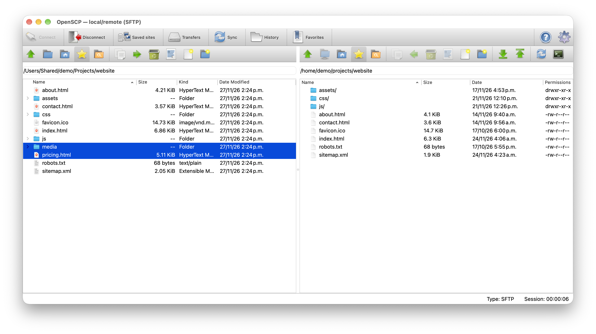
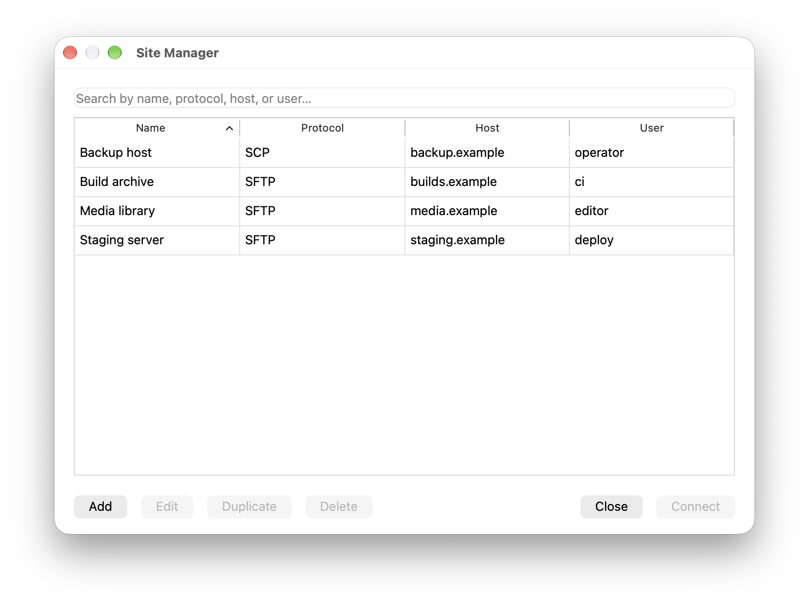
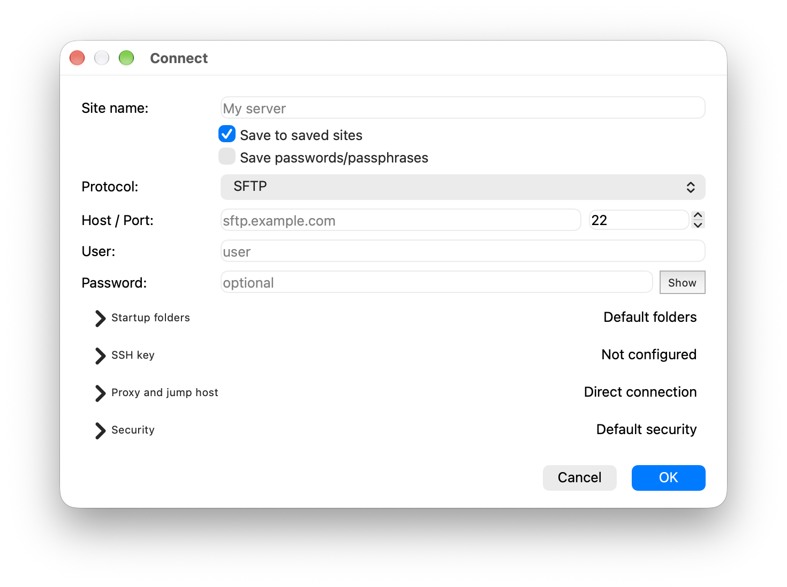
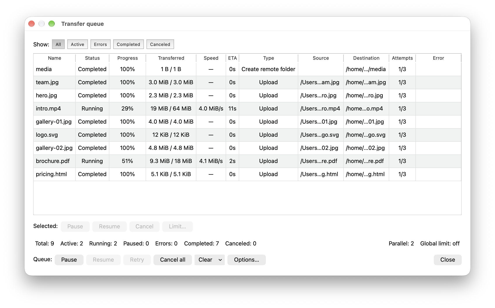
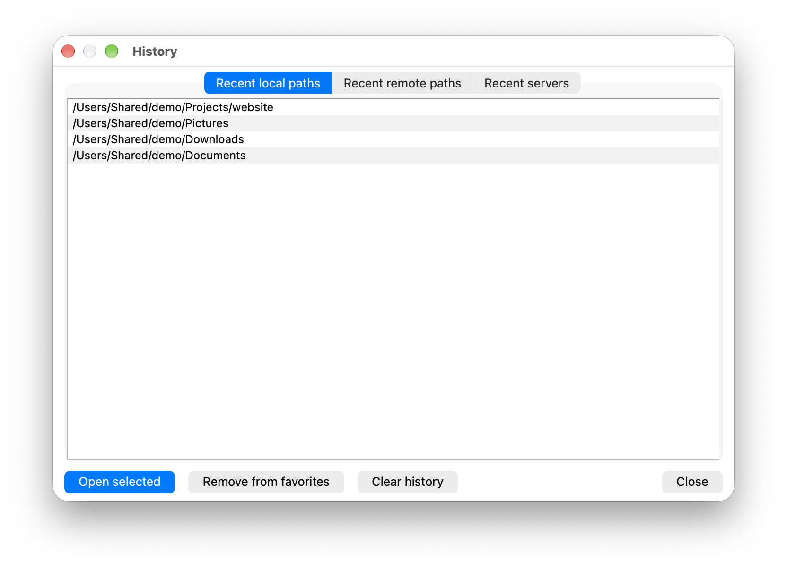
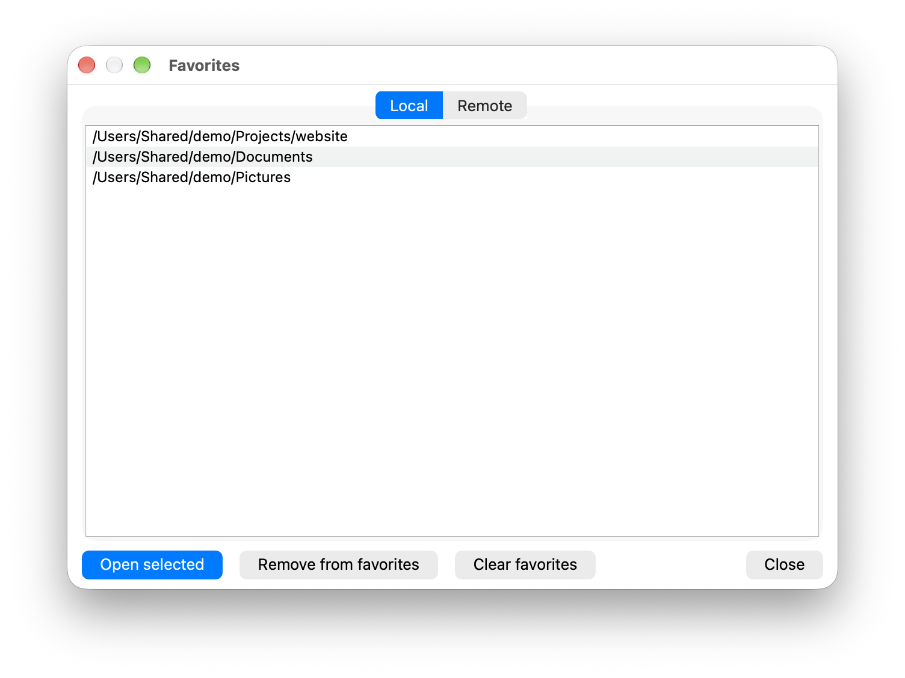
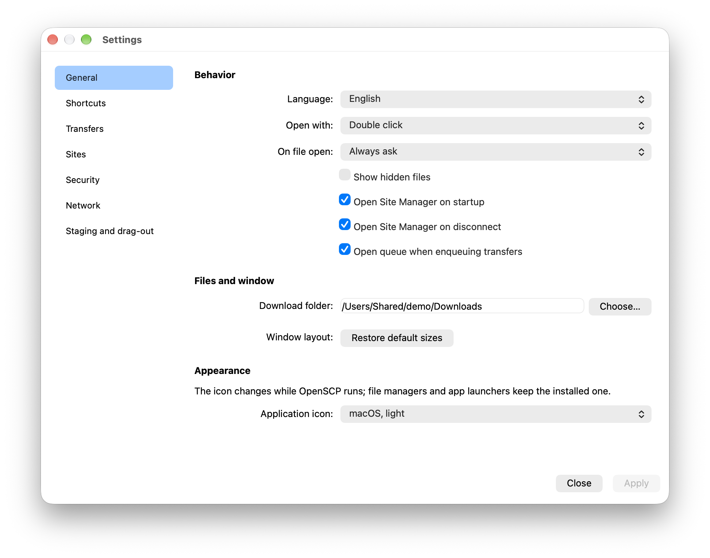
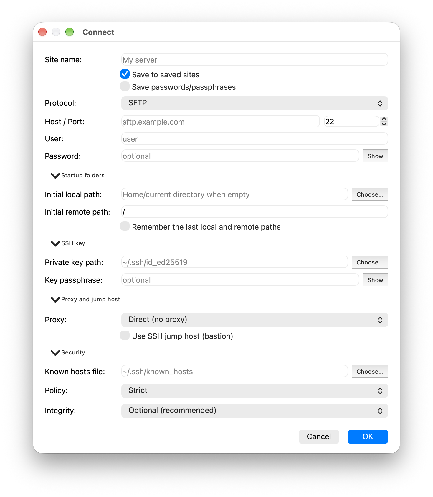

<div align="center">
  
  <h1>OpenSCP</h1>

  <p><strong>Un cliente multiplataforma de SFTP, SCP, FTP, FTPS y WebDAV con una interfaz de doble panel al estilo de WinSCP.</strong></p>
  <p><a href="https://github.com/luiscuellar31/openscp/releases/latest"></a></p>
  <p><a href="#descarga">Descarga</a> · <a href="#características">Características</a> · <a href="#capturas">Capturas</a> · <a href="#documentación">Documentación</a> · <a href="README.md">Read in English</a></p>

  
</div>

OpenSCP mueve y administra archivos entre tu equipo y un servidor. Muestra los
archivos locales y remotos lado a lado en dos paneles, con cola de
transferencias, sincronización en un sentido y opciones seguras por defecto, y
funciona en macOS, Linux y Windows.

## Características

- **Dos paneles:** archivos locales y remotos lado a lado, con rutas planas y
  clicables, diálogo para abrir directorios, historial, favoritos, búsqueda y
  la posibilidad de arrastrar y soltar.
- **Protocolos:** SFTP, SCP, FTP, FTPS y WebDAV. El paquete Flatpak solo trae
  SFTP y SCP; consulta la
  [matriz de protocolos](docs/PLATFORM_COMPATIBILITY.md#protocol-availability-by-build).
- **Transferencias:** cola persistente con transferencias en paralelo, pausa,
  reanudación, reintentos, políticas de conflicto, límites de ancho de banda y
  archivos `.part` reanudables.
- **Sitios guardados:** contraseñas en el Keychain de macOS, en Secret
  Service/libsecret en Linux y con cifrado DPAPI en Windows.
- **Identidad del servidor:** verificación de claves SSH estricta, con
  aceptación de claves nuevas o deshabilitada explícitamente. Las claves que
  `known_hosts` marca como `@revoked` se rechazan, como hace OpenSSH. FTPS y
  WebDAV por HTTPS sin verificación del certificado siguen comprobando la clave
  pública del servidor, en la que confías en la primera conexión.
- **Proxies:** SOCKS5, HTTP CONNECT y servidores de salto SSH cuando el
  protocolo lo permite.
- **Sincronización:** en un sentido, con vista previa, filtros y sumas de
  comprobación opcionales.
- **Idiomas:** español, inglés, portugués, francés y alemán.

La [guía de uso](docs/USAGE_ES.md) explica cómo se comportan las conexiones,
las transferencias y la sincronización en los casos poco habituales.

## Capturas

<p align="center">
  
  
  
</p>

<p align="center">
  
  
  
</p>

<details>
  <summary>Opciones avanzadas de conexión</summary>
  <p align="center">
    
  </p>
</details>

## Descarga

Los binarios precompilados de cada versión etiquetada están en la
[página de Releases](https://github.com/luiscuellar31/openscp/releases/latest).

| Plataforma | Archivo |
| --- | --- |
| macOS 13 o posterior, Apple Silicon | `OpenSCP-<versión>-arm64-UNSIGNED.dmg` |
| macOS 13 o posterior, Intel | `OpenSCP-<versión>-x86_64-UNSIGNED.dmg` |
| Linux x86_64, glibc 2.34 o posterior | `OpenSCP-<versión>-x86_64.AppImage` |
| Linux ARM64, glibc 2.39 o posterior | `OpenSCP-<versión>-aarch64.AppImage` |
| Linux x86_64, paquete Flatpak | `OpenSCP-x86_64.flatpak` |
| Linux ARM64, paquete Flatpak | `OpenSCP-aarch64.flatpak` |
| Windows 10 versión 1809 o posterior, x64 | `OpenSCP-<versión>-x64-setup.exe` |
| Windows 10 versión 1809 o posterior, x64, MSI para todos los usuarios | `OpenSCP-<versión>-x64.msi` |

Cada versión incluye un `SHA256SUMS.txt` que cubre todos esos archivos.
Descárgalo junto al que hayas elegido y compruébalos juntos:

```bash
shasum -a 256 -c SHA256SUMS.txt --ignore-missing  # macOS
sha256sum -c SHA256SUMS.txt --ignore-missing      # Linux
```

En Windows, PowerShell muestra `True` cuando el archivo coincide:

```powershell
$file = 'OpenSCP-<versión>-x64-setup.exe'
(Get-FileHash $file).Hash -eq (-split (Select-String -Path SHA256SUMS.txt -SimpleMatch "  $file").Line)[0]
```

Las sumas de comprobación detectan una descarga dañada, no un archivo
sustituido. Para confirmar que un archivo lo generó el workflow de publicación
de este repositorio, usa la [CLI de GitHub](https://cli.github.com/):

```bash
gh attestation verify OpenSCP-<versión>-x86_64.AppImage --repo luiscuellar31/openscp
```

### macOS

Abre el DMG, arrastra OpenSCP a la carpeta Aplicaciones y ábrelo desde ahí.

La primera apertura queda bloqueada: macOS indica que no puede comprobar si la
aplicación contiene software malicioso. Esa comprobación está reservada al
software firmado con un Apple Developer ID de pago, y OpenSCP no está inscrito
en ese programa, así que todas sus compilaciones reciben el mismo aviso
independientemente de su contenido. La suma de verificación publicada es lo que
te permite validar la descarga.

Para permitirla, abre **Ajustes del Sistema → Privacidad y seguridad**, baja
hasta la sección Seguridad, pulsa **Abrir igualmente** junto al mensaje sobre
OpenSCP y confirma. A partir de ahí OpenSCP se abre con normalidad, también
después de reiniciar.

El equivalente desde la terminal:

```bash
xattr -dr com.apple.quarantine /Applications/OpenSCP.app
```

Dos consecuencias que conviene conocer: en macOS 15 y posteriores el antiguo
atajo de Control-clic → Abrir ya no funciona, por lo que la ruta de Privacidad
y seguridad es la única disponible en la interfaz; y como las compilaciones sin
firmar no tienen una identidad estable, macOS vuelve a pedir permiso de llavero
después de cada actualización cuando OpenSCP lee tus contraseñas guardadas.

### Linux

El AppImage no requiere instalación y funciona en la mayoría de distribuciones:

```bash
chmod +x OpenSCP-<versión>-x86_64.AppImage
./OpenSCP-<versión>-x86_64.AppImage
```

El paquete Flatpak se integra con el escritorio y se ejecuta confinado:

```bash
flatpak remote-add --user --if-not-exists flathub https://flathub.org/repo/flathub.flatpakrepo
flatpak install --user ./OpenSCP-x86_64.flatpak
flatpak run io.github.luiscuellar31.openscp
```

El remoto de Flathub es necesario porque el paquete depende del entorno de
ejecución de KDE.

### Windows

OpenSCP necesita Windows 10 versión 1809 o posterior, o Windows 11, en x64.
Ejecuta `OpenSCP-<versión>-x64-setup.exe`: instala OpenSCP para tu usuario, sin
permisos de administrador, salvo que elijas instalarlo para todos los usuarios.
Para herramientas de despliegue, el MSI lo instala para todos los usuarios,
también en silencio:

```powershell
msiexec /i OpenSCP-<versión>-x64.msi /qn
```

Los instaladores no tienen firma de código, así que SmartScreen muestra
**Windows protegió su PC** la primera vez. Pulsa **Más información** y luego
**Ejecutar de todas formas**. Igual que en macOS, la suma de verificación
publicada es lo que te permite validar la descarga.

**Abrir en terminal** y los servidores de salto SSH usan el cliente OpenSSH de
Windows; si falta, agrega **Cliente OpenSSH** en **Características opcionales**
de la Configuración de Windows.

Como un navegador, OpenSCP marca los archivos que descarga como procedentes de
Internet, así que Windows los revisa antes de abrirlos. Los servidores que
agregues a **Intranet local** o **Sitios de confianza** en Opciones de Internet
no se marcan.

### Actualizaciones

Usa **OpenSCP → Buscar actualizaciones…** (**Ayuda → Buscar actualizaciones…**
en Windows) para consultar la última versión estable. **Buscar actualizaciones
automáticamente** activa una consulta diaria; está desactivada por defecto. Que
OpenSCP pueda instalar la actualización por sí mismo depende de cómo lo
instalaste: consulta [Cómo actualizar OpenSCP](docs/UPDATES.md).

## Compilar desde el código fuente

OpenSCP está escrito en C++20 con Qt 6 y se compila en Linux, macOS y Windows.
Requiere Qt 6, CMake 3.22+, libssh2 y OpenSSL. libcurl habilita FTP y FTPS;
WebDAV requiere libcurl y tinyxml2. En Windows lo compila Visual Studio 2022
con Qt para MSVC, y vcpkg compila las demás bibliotecas.

```bash
git clone https://github.com/luiscuellar31/openscp.git
cd openscp

# Linux
./scripts/linux.sh dev

# macOS
./scripts/macos.sh dev
```

```powershell
# Windows (PowerShell)
$env:VCPKG_ROOT = 'C:\ruta\a\vcpkg'
.\scripts\windows.ps1 dev
```

Consulta [Compilar OpenSCP](docs/BUILDING.md) para dependencias por plataforma,
pasos manuales, empaquetado y solución de problemas.

## Documentación

- [Cómo usar OpenSCP](docs/USAGE_ES.md)
- [Atajos de teclado](docs/KEYBOARD_SHORTCUTS.md)
- [Cómo actualizar OpenSCP](docs/UPDATES.md)
- [Compatibilidad de plataformas y protocolos](docs/PLATFORM_COMPATIBILITY.md)
- [Compilación y empaquetado](docs/BUILDING.md)
- [Arquitectura](docs/ARCHITECTURE.md)
- [Pruebas de accesibilidad](docs/ACCESSIBILITY.md)
- [Contribuciones y traducciones](CONTRIBUTING.md)
- [Política de seguridad](SECURITY.md)
- [Licenciamiento](docs/LICENSING.md)

## Roadmap

- Firmar los paquetes de Windows.
- Probar WebDAV con una mayor variedad de servidores.
- Ampliar la autenticación interactiva y las configuraciones empresariales de
  proxies y servidores de salto SSH.
- Añadir una paleta de comandos y temas seleccionables.

## Contribuir

Las contribuciones son bienvenidas. Lee [CONTRIBUTING.md](CONTRIBUTING.md)
antes de abrir un pull request: `main` contiene el trabajo estable y `dev`
recibe los pull requests. Reporta vulnerabilidades de forma privada como indica
[SECURITY.md](SECURITY.md).

## Licencia

OpenSCP está disponible bajo GPLv3-only o una licencia comercial. Los
componentes de terceros conservan sus propias licencias; consulta
[Licenciamiento](docs/LICENSING.md) y los
[créditos de terceros](docs/credits/CREDITS.md).
